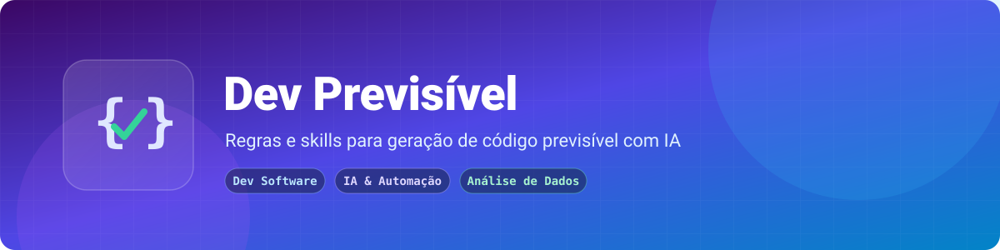
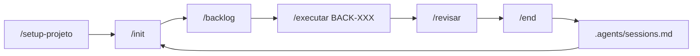
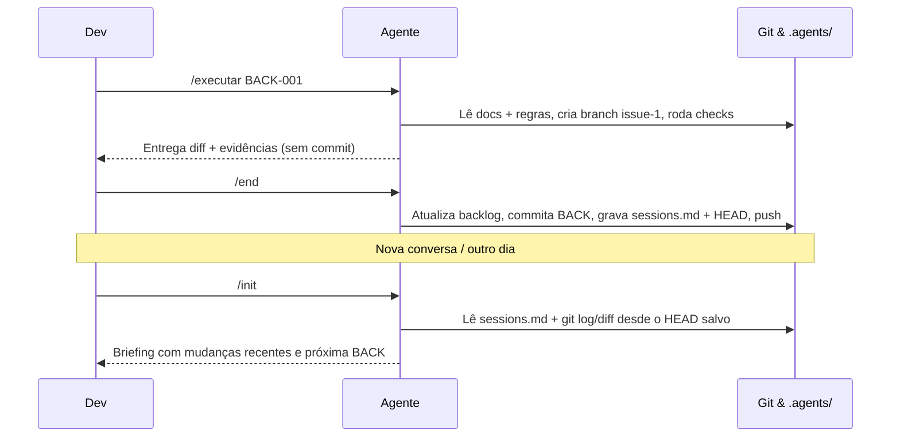

<div align="center">



<p>
  
  
  <a href="https://github.com/MATHEUSele/skills/actions/workflows/validate.yml">
    
  </a>
</p>

**Código gerado por IA não precisa ser loteria.**  
Um plugin único com regras fixas, templates versionados e skills de ponta a ponta para transformar escopo em entrega previsível.

[Por que usar](#-por-que-usar) •
[Fluxo de trabalho](#-fluxo-de-trabalho) •
[Comandos](#-comandos) •
[Perfis](#-perfis-suportados) •
[Estrutura](#-estrutura) •
[Instalação](#-instalação) •
[Roadmap](#-roadmap-e-validação)

</div>

---

## 🎯 Por que usar

Quando você só cola um prompt em um projeto novo, cada modelo inventa uma estrutura diferente, esquece decisões da conversa passada e commita arquivos fora de hora.

O **Dev Previsível** fixa no repositório o que precisa ser determinístico:
- **Documentação como fonte da verdade:** 5 documentos técnicos padronizados + regras por perfil em `.agents/`.
- **Revisão anti-viés:** `/revisar` usa subagente em contexto isolado (quando suportado), checklist antes do diff e testes adversariais de borda para evitar viés de confirmação.
- **Documentação visual padronizada:** `/readme` gera `README.md` e SVGs (banner, logo e demo animado) fiéis ao projeto.
- **Memória entre sessões:** `.agents/sessions.md` guarda decisões e o `HEAD` do git para que o `/init` retome exatamente de onde parou — inclusive detectando mudanças feitas por colegas.
- **Portátil entre ferramentas:** os mesmos arquivos funcionam no **Antigravity**, **Claude Code** e **Cursor**.

<div align="center">
  
</div>

---

## 🔄 Fluxo de trabalho



> Sob demanda (após setup ou entregas), use `/readme` para gerar ou atualizar o `README.md` e os SVGs em `assets/`.

### Ciclo de memória entre sessões



---

## ⚡ Comandos

| Comando | Emoji | O que faz | Altera arquivos? |
|---|:---:|---|:---:|
| `/setup-projeto` | 🛠️ | Cria `.agents/` (config, 5 docs, backlog, `sessions.md`, stack) e adaptadores | Sim |
| `/init` | 🧭 | Lê `sessions.md` + `git log/diff` desde a última sessão e entrega briefing | Não |
| `/backlog` | 📋 | Renderiza Issues e BACKs com resumo por status e próxima task livre | Não |
| `/executar <BACK-ID>` | ⚙️ | Lê os docs, muda para branch da Issue, implementa e roda `checks` | Sim |
| `/revisar [BACK-ID]` | 🔍 | Auditoria adversarial (subagente isolado quando suportado) contra docs, regras, casos de borda e checks | Não |
| `/end` | ✅ | Atualiza backlog, faz stage seletivo, commit, grava `sessions.md` e push | Sim |
| `/post` | ✍️ | Sugere temas, redige post de LinkedIn, gera arte 1:1 e registra no histórico | Sim |
| `/conselho <decisão>` | 🏛️ | Protocolo LLM Council: 5 conselheiros, revisão anônima e veredito | Não |
| `/readme` | 🎨 | Gera ou atualiza `README.md` e SVGs (banner, logo e demo animado) no padrão visual do plugin | Sim |

---

## 🧩 Perfis suportados

Em `.agents/project.config.yml`, o campo `project.profile` escolhe o módulo de regras e as seções extras aplicadas aos 5 documentos técnicos:

| Perfil (`profile`) | Módulo em `rules/stacks/` | O que padroniza |
|---|---|---|
| `dev` | [`dev-software.md`](rules/stacks/dev-software.md) | Camadas separadas, validação na borda, erros tipados, migrations versionadas e testes unitários/integração |
| `ia-automacao` | [`ia-automacao.md`](rules/stacks/ia-automacao.md) | `prompts/` versionados, `tools/` isoladas, `workflows/` com estado explícito, timeouts/retentativas/idempotência e `evals/` |
| `dados` | [`analise-dados.md`](rules/stacks/analise-dados.md) | `data/raw/` imutável, lógica extraída de notebooks para `src/`, validação de schema, KPIs documentados e `.gitignore` seguro |

> Todos os módulos de stack trazem padrões iniciais ajustáveis. É possível combinar módulos extras via `project.stack: [...]` ou criar novos a partir de [`rules/stacks/_TEMPLATE.md`](rules/stacks/_TEMPLATE.md).

---

## 🗂️ Estrutura

<details open>
<summary><b>Repositório do plugin vs. o que cada projeto recebe</b></summary>

<table>
<tr>
<th width="50%">Plugin (<code>dev-previsivel</code>)</th>
<th width="50%">Projeto alvo (após <code>/setup-projeto</code>)</th>
</tr>
<tr>
<td>

```text
skills/
├─ plugin.json
├─ .claude-plugin/plugin.json
├─ assets/
│  ├─ banner.svg
│  ├─ logo.svg
│  └─ demo.svg
├─ rules/
│  ├─ AGENTS.md
│  ├─ code-style.md
│  └─ stacks/
│     ├─ dev-software.md
│     ├─ ia-automacao.md
│     ├─ analise-dados.md
│     └─ _TEMPLATE.md
├─ skills/
│  ├─ setup-projeto/SKILL.md
│  ├─ init/SKILL.md
│  ├─ backlog/SKILL.md
│  ├─ executar/SKILL.md
│  ├─ revisar/SKILL.md
│  ├─ end/SKILL.md
│  ├─ post/SKILL.md
│  ├─ conselho/SKILL.md
│  └─ readme/SKILL.md
├─ templates/
│  ├─ project.config.yml
│  ├─ docs-outline.md
│  ├─ backlog.md
│  ├─ sessions.md
│  ├─ adapters/
│  └─ readme/
├─ scripts/validate.py
└─ docs/origem/prompt_original.txt
```

</td>
<td>

```text
meu-projeto/
├─ AGENTS.md
├─ CLAUDE.md
├─ .cursor/
│  └─ rules/core.mdc
└─ .agents/
   ├─ project.config.yml
   ├─ backlog.md
   ├─ sessions.md
   ├─ stacks/
   │  └─ <perfil>.md
   ├─ 01_system_architecture.md
   ├─ 02_data_model_and_persistence.md
   ├─ 03_business_rules_and_logic.md
   ├─ 04_api_and_integration_specs.md
   └─ 05_devops_ci_cd_deployment.md
```

</td>
</tr>
</table>

</details>

---

## 🚀 Instalação

<details>
<summary><b>Antigravity</b></summary>

O `plugin.json` na raiz transforma este repositório em um plugin pronto:
1. Copie ou clone esta pasta para `~/.gemini/config/plugins/dev-previsivel/`.
2. Ative na tela de Customizations e use `/setup-projeto`, `/init`, `/backlog`, `/executar`, `/revisar`, `/end`, `/post`, `/conselho` e `/readme`.

</details>

<details>
<summary><b>Claude Code</b></summary>

O diretório `.claude-plugin/plugin.json` + `skills/` é compatível nativamente com o Claude Code:

```bash
claude --plugin-dir /caminho/para/skills
```

> **Nota sobre `/init`:** o Claude Code já possui um comando nativo `/init` para gerar `CLAUDE.md`. Para acionar a skill de retomada de sessão deste plugin no Claude Code, use **`/dev-previsivel:init`**.

</details>

<details>
<summary><b>Cursor</b></summary>

> **Limitação conhecida:** o Cursor não possui instalador de plugins de skills como Antigravity e Claude Code.

Ao rodar `/setup-projeto` uma vez no repositório do projeto, ele gera `AGENTS.md` e `.cursor/rules/core.mdc` (`alwaysApply: true`). A partir daí, o Cursor passa a seguir todas as regras core e consultar `.agents/` automaticamente.

</details>

---

## 🛠️ Roadmap e validação

- **Validador local e CI:** toda alteração passa por `python scripts/validate.py` (e pelo workflow [`.github/workflows/validate.yml`](.github/workflows/validate.yml)), checando manifests JSON, frontmatter das skills, referências internas e presença dos 3 módulos de perfil.
- **Pendências do plugin:**
  - Fechar as decisões transversais em [`rules/code-style.md`](rules/code-style.md) (idioma de identificadores, convenção de nomes, cobertura mínima, logging).
  - Avaliar um comando opcional `/salvar` para registrar `.agents/sessions.md` em pausas sem commit de código.
