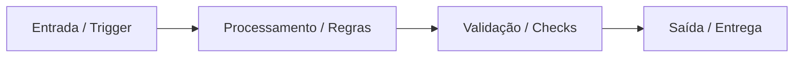

<div align="center">


<p>
  
  
  <!-- Incluir badge de CI apenas se existir .github/workflows/<arquivo>.yml -->
  <!-- Incluir badge de licença apenas se existir arquivo LICENSE -->
</p>

**{{FRASE_IMPACTO}}**  
{{SUBTITULO_CURTO}}

[Por que usar](#-por-que-usar) •
[Fluxo e arquitetura](#-fluxo-e-arquitetura) •
[Funcionalidades](#-funcionalidades-e-comandos) •
[Estrutura](#-estrutura) •
[Instalação e uso](#-instalação-e-uso) •
[Validação e roadmap](#-validação-e-roadmap)

</div>

---

## 🎯 Por que usar

{{PROBLEMA_QUE_RESOLVE}}

- **{{DIFERENCIAL_1_TITULO}}:** {{DIFERENCIAL_1_DESC}}
- **{{DIFERENCIAL_2_TITULO}}:** {{DIFERENCIAL_2_DESC}}
- **{{DIFERENCIAL_3_TITULO}}:** {{DIFERENCIAL_3_DESC}}

<div align="center">
  
</div>

---

## 🔄 Fluxo e arquitetura



<!-- Opcional: incluir sequenceDiagram quando o projeto tiver interação entre cliente/agente/serviços -->

---

## ⚡ Funcionalidades e comandos

| Item / Comando | Emoji | O que faz | Entrada / Saída |
|---|:---:|---|---|
| `{{CMD_EXEMPLO}}` | ⚙️ | {{DESCRICAO_CMD}} | {{IO_CMD}} |

---

## 🗂️ Estrutura

<details open>
<summary><b>Árvore de diretórios do projeto</b></summary>

```text
{{ARVORE_REAL_DO_REPOSITORIO}}
```

</details>

---

## 🚀 Instalação e uso

<details open>
<summary><b>Pré-requisitos e configuração local</b></summary>

```bash
{{COMANDOS_INSTALACAO_REAIS}}
```

</details>

<details>
<summary><b>Execução e testes</b></summary>

```bash
{{COMANDOS_EXECUCAO_E_TESTES_REAIS}}
```

</details>

---

## 🛠️ Validação e roadmap

- **Checks automatizados:** {{CHECKS_REAIS}}
- **Próximos passos:** {{PROXIMOS_PASSOS}}
